# 🩺 OpenHealth

### AI-Powered Healthcare Platform with Disease Prediction, Medicine Recognition, Symptom Checker, Chatbot & Doctor Consultation

<p align="center">
  <strong>OpenHealth</strong> brings multiple healthcare-support workflows together in one modular Flask application.
</p>

<p align="center">
  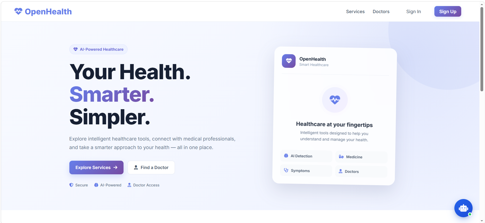
</p>

---

## 📌 Overview

**OpenHealth** is a web-based healthcare-support platform built with **Python and Flask**. It combines AI/ML-supported disease prediction, medicine recognition, symptom checking, doctor discovery, appointment booking, doctor availability management, role-based authentication, health records, and a floating conversational assistant.

The project is designed as a **healthcare-support application**, not as a replacement for professional medical diagnosis or treatment.

### What OpenHealth provides

- AI/ML-supported disease prediction interfaces
- Medicine recognition using image upload, OCR/image processing, and a medicine database
- AI Symptom Checker
- Patient and doctor authentication
- Google OAuth sign-in
- Separate patient and doctor dashboards
- Database-driven doctor discovery
- Doctor availability management
- Appointment booking with consultation type selection
- Health prediction history / health records
- Floating OpenHealth Assistant
- General wellness information and feature navigation

---

## ✨ Key Features

| Feature | Description |
|---|---|
| 🔐 Authentication | Patient/doctor registration, sign-in, logout and protected workflows |
| 🔑 Google OAuth | Google-based authentication option |
| 👤 Patient Dashboard | Patient-focused appointments, health tools and records |
| 🩺 Doctor Dashboard | Doctor profile, appointments, statistics and professional information |
| 🧠 Disease Prediction | Separate prediction/detection workflows for supported conditions |
| 💊 Medicine Recognition | Search medicine by name or upload a medicine image |
| 🔎 Symptom Checker | Browse/search symptoms and use the application's symptom-analysis workflow |
| 👨‍⚕️ Doctor Discovery | Search and explore database-driven doctors and specialties |
| 📅 Appointment Booking | Select doctor, date, time and consultation type |
| 🗓️ Doctor Availability | Doctors configure weekdays, time ranges and consultation modes |
| 📋 Health Records | Store and review AI prediction history |
| 💬 Health Chatbot | Health information, wellness guidance and feature quick actions |
| 🗄️ MySQL | Persistent storage for users, doctors, appointments and health records |

---

## 🧠 Disease Prediction Modules

The Healthcare Services area currently contains eight disease-related prediction/detection modules:

1. Breast Cancer
2. Heart Disease
3. Diabetes
4. Brain Tumor
5. Kidney Disease
6. Liver Disease
7. Parkinson's Disease
8. Malaria

The trained model artifacts required by the application are stored under the `artifacts/` directory.

> **Important:** Model outputs are application predictions/assessments and should not be treated as definitive medical diagnoses.

---

## 🏗️ System Architecture

OpenHealth follows a modular Flask architecture.

```text
                         ┌──────────────────────────┐
                         │       Web Browser        │
                         │ HTML / CSS / JavaScript  │
                         └────────────┬─────────────┘
                                      │
                                      ▼
                         ┌──────────────────────────┐
                         │       Flask App          │
                         │       main.py             │
                         └────────────┬─────────────┘
                                      │
                 ┌────────────────────┼────────────────────┐
                 ▼                    ▼                    ▼
        ┌────────────────┐   ┌────────────────┐   ┌────────────────┐
        │ Flask Routes / │   │    Services    │   │   Templates /  │
        │   Blueprints   │   │ Application    │   │ Static Assets  │
        └────────┬───────┘   │    Logic       │   └────────────────┘
                 │           └───────┬────────┘
                 │                   │
        ┌────────┴─────────┐         │
        ▼                  ▼         ▼
┌───────────────┐  ┌──────────────┐ ┌──────────────────┐
│ AI/ML Models  │  │ OCR / Image  │ │ MySQL Database   │
│ TensorFlow /  │  │ Processing   │ │ Users / Doctors  │
│ Scikit-learn  │  │ Tesseract   │ │ Appointments etc.│
└───────────────┘  └──────────────┘ └──────────────────┘
```

### Architecture layers

- **Presentation Layer:** Jinja2 templates, HTML, CSS and JavaScript
- **Routing Layer:** Flask blueprints for authentication, doctors, patients, appointments, chatbot, symptoms, medicine recognition and disease modules
- **Service Layer:** reusable application services
- **Data Layer:** MySQL database
- **AI/ML Layer:** trained prediction models and image/OCR components
- **Integration Layer:** Google OAuth and applicable APIs

---

## 🛠️ Technology Stack

### Backend
- Python
- Flask
- Jinja2

### Frontend
- HTML5
- CSS3
- JavaScript
- Responsive UI
- Font Awesome / Google Fonts where applicable

### Database
- MySQL
- `mysql-connector-python`

### AI / Machine Learning
- TensorFlow
- Keras
- Scikit-learn
- NumPy
- Pandas
- SciPy
- Joblib

### Image / OCR
- OpenCV
- Pillow
- Pytesseract
- Tesseract OCR

### Authentication & Integration
- Flask session-based authentication
- Authlib
- Google OAuth
- Environment-based configuration

### Development Tools
- Git
- GitHub
- Postman
- Swagger

---

# 📸 UI Showcase

The following screenshots are from the current OpenHealth interface.

## 🏠 Home Page

<p align="center">
  
</p>

The landing page provides access to OpenHealth services, doctor discovery, authentication and the floating assistant.

---

## 🔐 Authentication

### Sign In

<p align="center">
  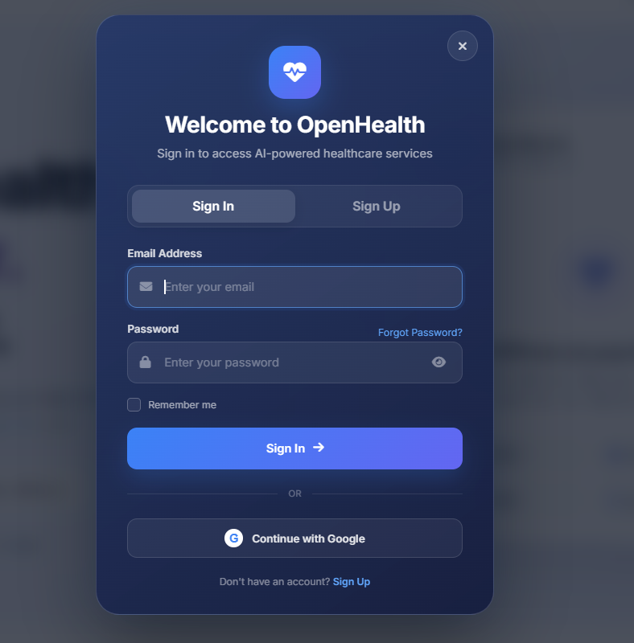
</p>

### Patient Sign Up

<p align="center">
  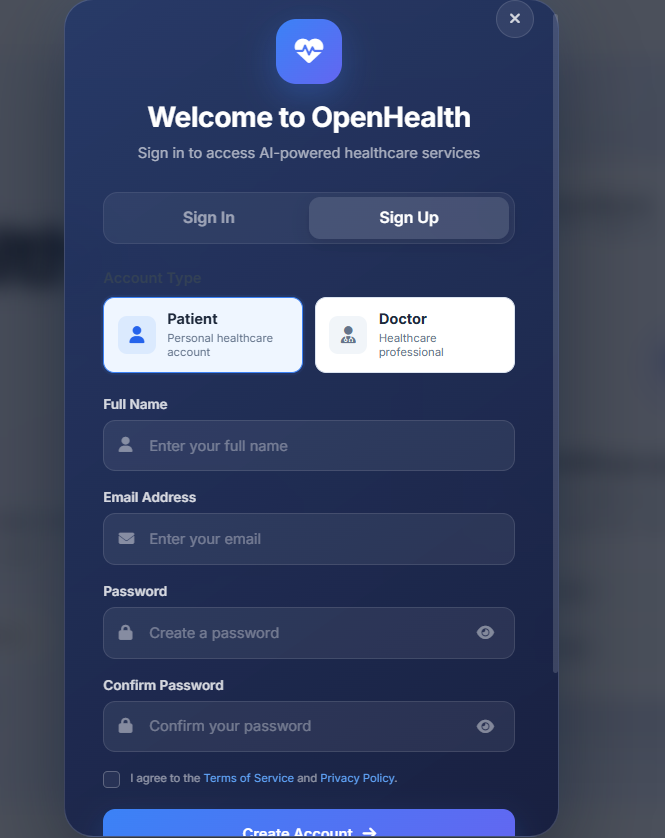
</p>

### Doctor Sign Up

<p align="center">
  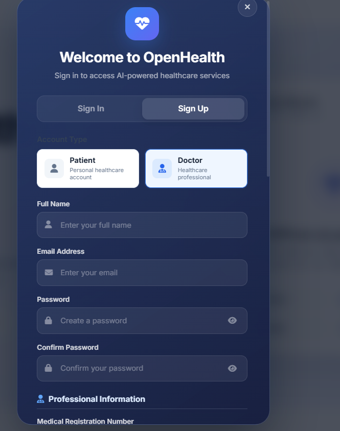
</p>

### Doctor Professional & Practice Information

<p align="center">
  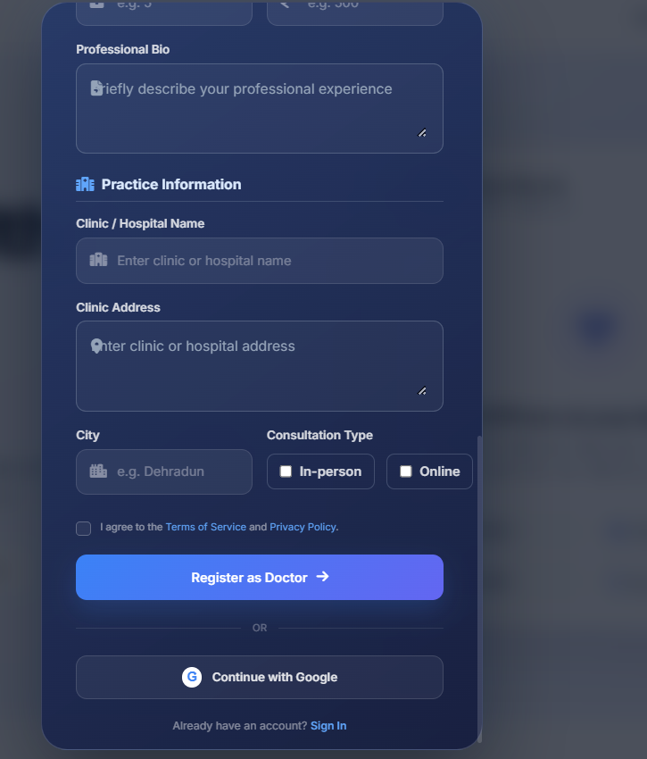
</p>

Doctor registration includes professional and practice information such as registration number, specialization, qualification, experience, clinic information and consultation type.

---

## 👤 Patient Dashboard

<p align="center">
  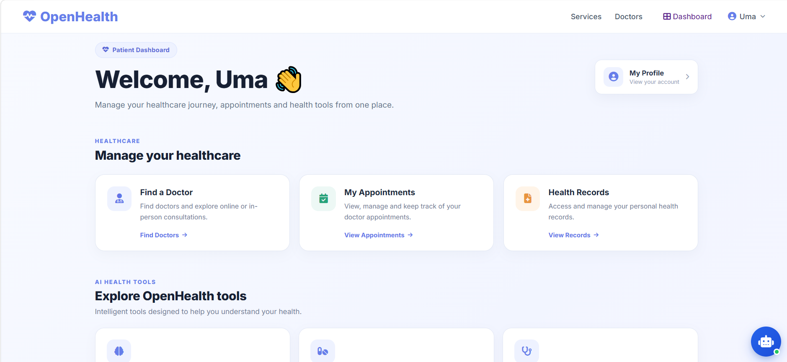
</p>

The patient dashboard provides access to:

- Doctor discovery
- Appointments
- Health records
- AI health tools
- Profile information

---

## 🩺 Doctor Dashboard

<p align="center">
  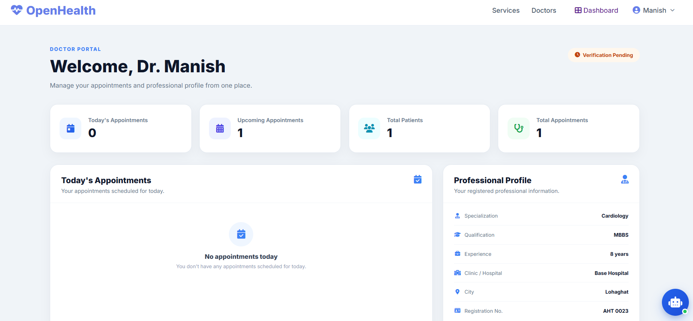
</p>

The doctor portal provides a separate role-specific experience with:

- Appointment statistics
- Upcoming appointments
- Patient information
- Professional profile
- Verification status

---

## 👨‍⚕️ Doctor Discovery

<p align="center">
  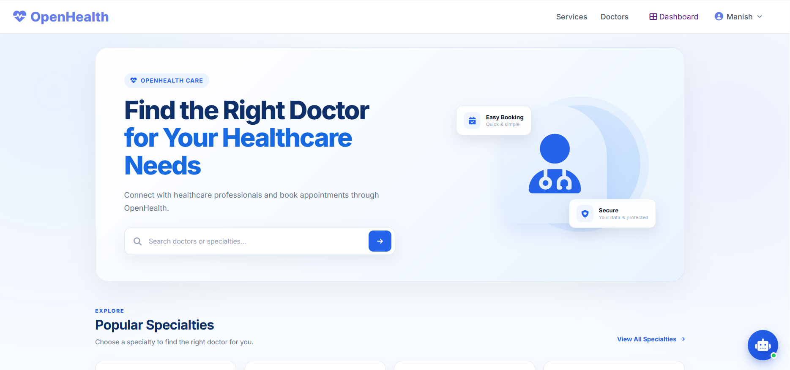
</p>

Patients can search for doctors or explore healthcare specialties.

### Popular Specialties

<p align="center">
  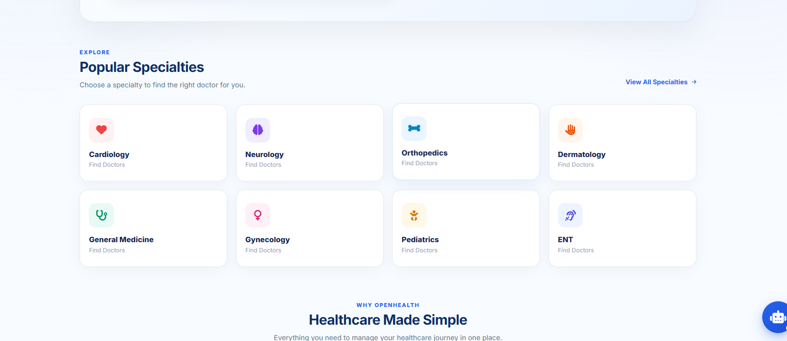
</p>

---

## 📅 Appointment Booking

<p align="center">
  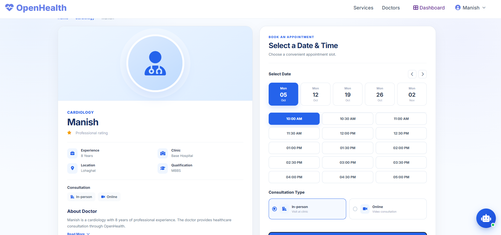
</p>

The appointment workflow allows a patient to:

1. Select a doctor
2. Select an available date
3. Select an available time slot
4. Select consultation type
5. Submit the appointment request

Doctor availability is database-driven, and the booking interface uses the configured availability and consultation modes.

---

## 🧠 Disease Prediction Services

<p align="center">
  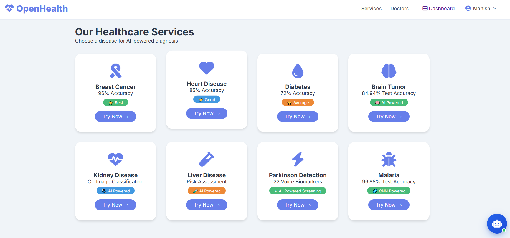
</p>

The Services page provides separate interfaces for the supported disease modules.

---

## 💊 Medicine Recognition

<p align="center">
  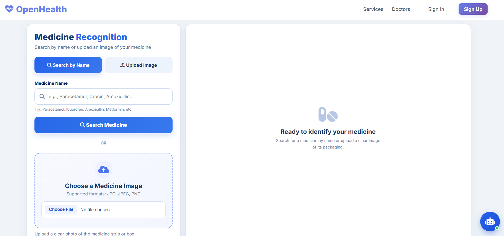
</p>

Medicine Recognition supports:

- Medicine name search
- Image upload
- OCR/image-processing workflow
- Medicine database information

Supported image formats in the application include common formats such as JPG, JPEG, PNG and other configured image types.

---

## 🔎 AI Symptom Checker

<p align="center">
  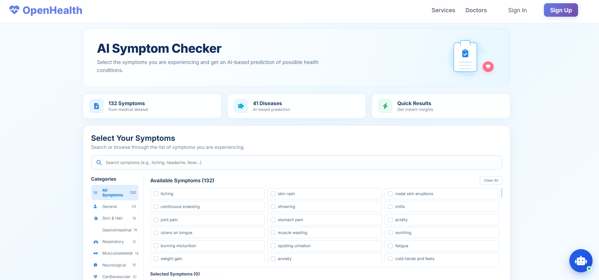
</p>

The Symptom Checker allows users to search and select symptoms and use the application's prediction workflow for possible health conditions.

---

## 📋 Health Records

<p align="center">
  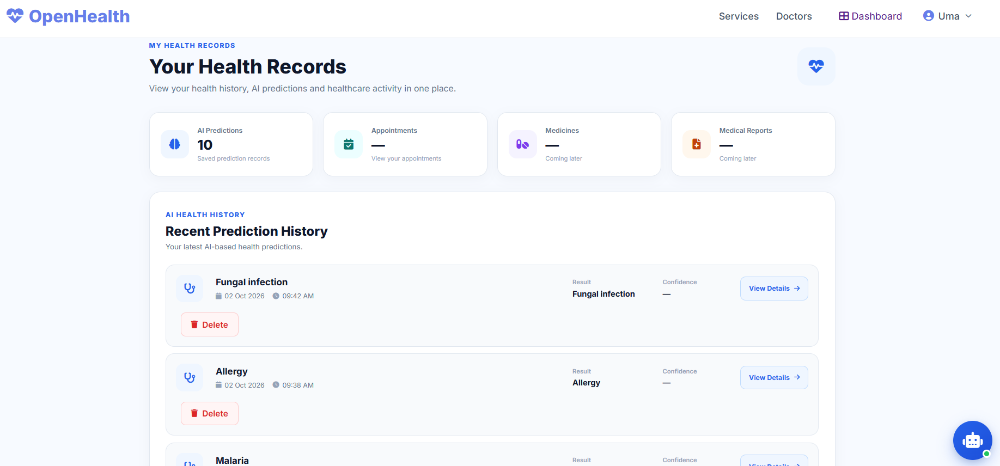
</p>

Health Records provides a central view of saved AI prediction history and related healthcare activity.

---

## 💬 OpenHealth Assistant

<p align="center">
  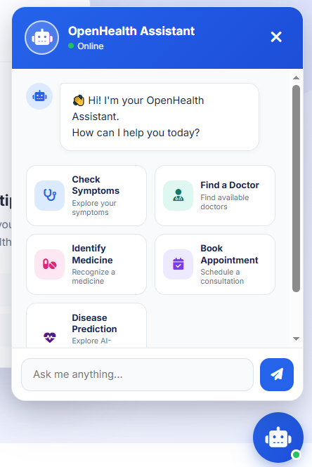
</p>

The floating **OpenHealth Assistant** provides:

- Basic health information
- General wellness guidance
- Symptom-related feature suggestions
- Doctor discovery
- Medicine Recognition
- Appointment navigation
- Disease Prediction navigation

### Chatbot Quick Actions

| User Intent | OpenHealth Feature |
|---|---|
| 🩺 Check symptoms | Symptom Checker |
| 👨‍⚕️ Find a doctor | Doctor Discovery |
| 💊 Identify medicine | Medicine Recognition |
| 📅 Book appointment | Doctor Appointment |
| ❤️ Disease prediction | Disease Services |

The chatbot uses predictable intent/keyword-based feature suggestions and keeps the user in control by providing actions rather than forcing navigation.

---

# 📂 Project Structure

The project follows a modular Flask structure similar to:

```text
open-health-ai-master/
│
├── app/
│   ├── database/
│   │   ├── connection.py
│   │   └── __init__.py
│   │
│   ├── routes/
│   │   ├── auth_routes.py
│   │   ├── chatbot_routes.py
│   │   ├── general_routes.py
│   │   ├── medicine_routes.py
│   │   ├── symptom_routes.py
│   │   ├── doctor routes / appointment routes
│   │   └── disease routes
│   │
│   ├── services/
│   │   ├── authentication services
│   │   ├── doctor services
│   │   ├── appointment services
│   │   ├── chatbot services
│   │   └── related application logic
│   │
│   └── ...
│
├── artifacts/
│   ├── Brain Tumour/
│   ├── Breast Cancer/
│   ├── Diabetes/
│   ├── Heart/
│   ├── Kidney/
│   ├── Liver Disease/
│   ├── Malaria/
│   ├── Parkinson's/
│   └── Symptom Checker/
│
├── data/
│   └── medicines.json
│
├── database/
│   └── schema.sql
│
├── static/
│   ├── css/
│   ├── js/
│   └── ...
│
├── templates/
│   ├── appointment/
│   ├── components/
│   ├── diseases/
│   ├── doctor/
│   ├── home/
│   ├── medicine/
│   ├── patient/
│   ├── services/
│   └── shared templates
│
├── .env.example
├── .gitignore
├── main.py
├── requirements.txt
└── README.md
```

> Runtime/generated directories such as `venv/`, `.env`, `uploads/`, datasets and notebook experiments are intentionally excluded from version control.

---

# 💻 Installation & Setup

## 1. Prerequisites

Before running OpenHealth, install:

- **Python 3.12.x** recommended for the current development environment
- **MySQL 8.x**
- **Tesseract OCR** for medicine image OCR
- Git
- A Google Cloud project only if Google Sign-In is required

---

## 2. Clone the Repository

After the GitHub repository is created:

```bash
git clone <YOUR_GITHUB_REPOSITORY_URL>
cd open-health-ai-master
```

---

## 3. Create a Virtual Environment

### Windows PowerShell

```powershell
python -m venv venv
.\venv\Scripts\Activate.ps1
```

### Windows CMD

```cmd
python -m venv venv
venv\Scripts\activate
```

---

## 4. Install Python Dependencies

```bash
pip install -r requirements.txt
```

The requirements file includes the project's main Flask, ML, OCR, database, authentication and supporting dependencies.

---

# 🔐 Environment Configuration

OpenHealth keeps private configuration outside the source code.

Copy the example environment file:

### PowerShell

```powershell
Copy-Item .env.example .env
```

Then open `.env` and provide your own values.

### Required configuration

```env
# MySQL Database
MYSQL_HOST=localhost
MYSQL_PORT=3306
MYSQL_USER=your_mysql_username
MYSQL_PASSWORD=your_mysql_password
MYSQL_DATABASE=openhealth

# Email Configuration
MAIL_SERVER=your_mail_server
MAIL_PORT=587
MAIL_USERNAME=your_email
MAIL_PASSWORD=your_email_password

# Flask
FLASK_SECRET_KEY=your_flask_secret_key

# Google OAuth
GOOGLE_CLIENT_ID=your_google_client_id
GOOGLE_CLIENT_SECRET=your_google_client_secret
```

### ⚠️ Never commit `.env`

Your real `.env` file contains private credentials and must remain local.

The repository should contain:

```text
.env.example    ✅
.env            ❌
```

---

# 🗄️ MySQL Database Setup

OpenHealth uses MySQL for persistent application data.

The repository includes a clean schema file:

```text
database/schema.sql
```

### Database tables

The schema creates:

- `users`
- `doctors`
- `appointments`
- `doctor_availability`
- `email_verification_codes`
- `health_prediction_records`

### Option A — MySQL Workbench

1. Open MySQL Workbench.
2. Connect to your local MySQL server.
3. Open:

```text
database/schema.sql
```

4. Execute the script.
5. Confirm that the `openhealth` database and required tables were created.

### Option B — MySQL command line

Open the MySQL client:

```bash
mysql -u root -p
```

Then run:

```sql
SOURCE path/to/open-health-ai-master/database/schema.sql;
```

The schema creates the `openhealth` database if it does not already exist.

> The schema contains table definitions only. It does **not** contain the existing development users, doctors, appointments, OTP records or health prediction records.

---

# 🔑 Google OAuth Setup

Google Sign-In is optional.

The application uses the OAuth callback route:

```text
/auth/google
/auth/google/callback
```

For local development, configure the Google OAuth application's authorized redirect URI to match your local application URL, for example:

```text
http://127.0.0.1:5000/auth/google/callback
```

Then place your own credentials in `.env`:

```env
GOOGLE_CLIENT_ID=your_google_client_id
GOOGLE_CLIENT_SECRET=your_google_client_secret
```

Never publish the client secret.

---

# 📧 Email / OTP Configuration

Email configuration is used by authentication workflows that require email verification.

Configure:

```env
MAIL_SERVER=your_mail_server
MAIL_PORT=587
MAIL_USERNAME=your_email
MAIL_PASSWORD=your_email_password
```

Use credentials belonging to the person running the application.

---

# 📷 Tesseract OCR Setup

Medicine Recognition uses Python OCR/image-processing libraries and requires the **Tesseract OCR application** to be installed separately on the machine.

### Windows

Install Tesseract OCR, then ensure the executable is available at the path expected by the application's OCR configuration.

If your Tesseract installation uses a different location, update the application's Tesseract executable configuration accordingly.

Python packages are already included in `requirements.txt`:

```text
pytesseract
Pillow
opencv-python
```

---

# 🤖 AI Model Artifacts

The repository includes trained model artifacts under:

```text
artifacts/
```

These artifacts are used by the application at runtime.

Because the trained models are already provided, users do **not** need to retrain the models simply to run the web application.

Large training datasets and experimentation files are intentionally excluded from the GitHub repository.

---

# ▶️ Run OpenHealth

After completing the setup:

### 1. Activate the virtual environment

```powershell
.\venv\Scripts\Activate.ps1
```

### 2. Make sure MySQL is running

Confirm that the MySQL server is available and the `.env` database credentials are correct.

### 3. Start Flask

```bash
python main.py
```

The application runs on:

```text
http://127.0.0.1:5000
```

Open the address in your browser.

---

# 🔄 Typical Application Workflow

```text
                         OpenHealth
                              │
                ┌─────────────┴─────────────┐
                │                           │
             Public                    Authentication
                │                           │
       ┌────────┼────────┐          ┌───────┴────────┐
       │        │        │          │                │
    Services  Doctors  Chatbot    Patient          Doctor
       │        │                   │                │
       ▼        ▼                   ▼                ▼
   Disease   Doctor Search      Patient DB      Doctor Portal
   Models    & Profile          & Records       & Availability
       │        │                   │                │
       └────────┴─────────────┬─────┴────────────────┘
                              ▼
                         MySQL Database
```

---

# 🧪 Testing & Development

The project was developed and tested iteratively across:

- Patient authentication
- Doctor authentication
- Role-based dashboard routing
- Database-driven doctor profiles
- Doctor availability
- Appointment date/time selection
- Consultation type synchronization
- Appointment creation
- Patient appointment display
- Medicine recognition
- Symptom Checker
- Disease modules
- Health records
- Chatbot popup and communication
- Chatbot quick actions
- Disease-information responses
- General wellness responses

---

# 🔒 Security Notes

OpenHealth uses several application-level security practices:

- Sensitive configuration is loaded from environment variables.
- `.env` is excluded from Git.
- Patient and doctor routes perform session/role checks.
- Database operations use parameterized queries in the relevant application services.
- Google OAuth credentials are not hard-coded in the intended configuration.
- Runtime uploads are excluded from version control.

### Important

A production healthcare system would require additional security, privacy, encryption, auditing, compliance and clinical-governance measures.

This project is intended as an educational/portfolio healthcare-support application.

---

# 🚫 Files Intentionally Excluded from GitHub

The project keeps some files locally but excludes them from version control.

| Directory / File | Reason |
|---|---|
| `venv/` | Local Python virtual environment |
| `.env` | Private credentials and secrets |
| `uploads/` | Runtime/user-uploaded files |
| `dataset/` | Large training dataset |
| `datasets/` | Local dataset files |
| `Notebook_Experiments/` | Training/experimentation data |
| `__pycache__/` | Python generated cache |
| `.vscode/` | Local editor configuration |

The required trained model artifacts remain in the repository under `artifacts/`.

---

# 🧭 Future Scope

Possible future improvements include:

- More advanced NLP/LLM-based chatbot intent recognition
- Richer conversational context and follow-up understanding
- Notifications and reminders
- Expanded patient records
- Multilingual support
- More documented model evaluation
- Stronger security and privacy controls
- Additional healthcare integrations
- Mobile application integration

---

# ⚠️ Medical Disclaimer

OpenHealth is a **healthcare-support and educational software project**.

Disease predictions, symptom results, medicine information and chatbot responses are not a substitute for professional medical advice, diagnosis or treatment.

Users should consult a qualified healthcare professional for medical decisions.

---

# 📄 Project Information

**Project:** OpenHealth  
**Category:** AI-Powered Healthcare Web Application  
**Backend:** Python / Flask  
**Frontend:** HTML / CSS / JavaScript / Jinja2  
**Database:** MySQL  
**AI/ML:** TensorFlow / Scikit-learn  
**OCR:** Tesseract / Pytesseract / OpenCV / Pillow  

---

## ⭐ Acknowledgement

OpenHealth was developed as a B.Tech Computer Science & Engineering project, combining web development, database systems, machine learning, OCR and healthcare-support workflows into a single application.

---

## 📜 License

No open-source license has been selected for this repository yet.

If you intend to allow others to reuse, modify or distribute the project, add an appropriate license file before publishing the repository.
